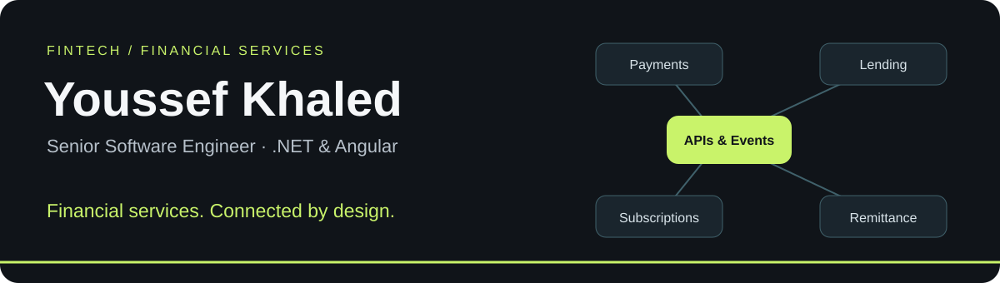
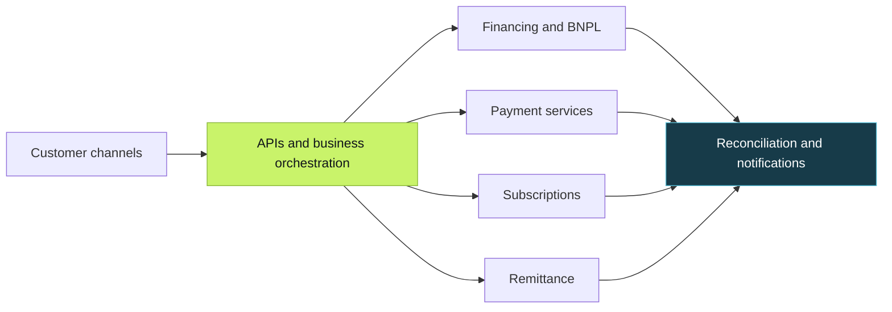

  

<h1 align="center">Hi, I'm Youssef 👋</h1>

<strong>Senior Software Engineer · Fintech & Financial Services · .NET & Angular</strong>

I connect business workflows, APIs, and services to build dependable software.

  
  
  
  

## 💡 About me

- 🏦 **Currently at PaySky**, contributing to financing, payment, and remittance platforms.
- 🔗 My focus is **financial-service integration**: turning business rules, APIs, and events into connected customer journeys.
- 🛠️ I work across backend services, Angular interfaces, data integrity, performance, and production troubleshooting.
- 🌍 Based in **Egypt** · Native Arabic · Advanced English.
- 💬 Happy to discuss **engineering roles, freelance projects, .NET, Angular, and fintech integrations**.

## 🏦 Financial services, connected by design

**Payments & integrations** · **Consumer finance & BNPL** · **Recurring collections** · **Remittance workflows**

*A conceptual view of the domains I work in, not a live system or a client's internal architecture.*

### Selected engineering contributions

- **Identity & reporting:** more complete Keycloak user exports, effective-permission reporting, eligibility filtering, and bounded parallel fetching.
- **Financial data integrity:** optimistic concurrency with row versions, explicit conflict handling, and rollback paths.
- **Payment-state consistency:** installment-status checks against a payment processor and synchronization of confirmed transactions.
- **Performance:** contributed to a reported **greater than 50% reduction in loan API processing time** at Fawry, as documented in my resume.

[Explore the workflows and project details →](https://youssefkhaled.pages.dev/#work)

## 🧭 My engineering journey

**PaySky · Senior Software Engineer**  
*Jul 2025 — Present*

BNPL, single-payment financing, and remittance platforms; payment integrations, Clean Architecture, DDD, CQRS, deployment, and observability.

**Sure Global Technology · Senior Software Engineer**  
*Aug 2024 — Jul 2025*

Vehicle lending and partner workflows for SDB Bank, including Dynamics 365 CRM integration and customer after-sales services with .NET, Angular, and ABP.

**Fawry · Software Engineer**  
*Mar 2022 — Aug 2024*

Consumer finance, loan APIs, scheduled jobs, database optimization, transaction management, and production support.

**nWeave · Associate Software Engineer**  
*Nov 2021 — Feb 2022*

Healthcare applications, Active Directory integration, clinical data routing with Mirth, and insurance-validation workflows.

## 🧰 Tools I work with

**Backend & architecture**

     

Clean Architecture · Domain-Driven Design · CQRS · MediatR · Microservices · SOLID · Design Patterns

**Frontend & data**

   

**Integration & operations**

   

Keycloak · Hangfire · Dynamics 365 · Active Directory · Mirth

## 🚀 Explore my public projects

### [🌐 Bilingual Engineering Portfolio](https://github.com/sa5ra2000/sa5ra2000.github.io)

My professional experience, selected work, interactive financial-service diagrams, and resume in English and Arabic. Built with HTML, CSS, and JavaScript.

**[Live portfolio](https://youssefkhaled.pages.dev/) · [GitHub Pages mirror](https://sa5ra2000.github.io/)**

### [✅ Todo REST API](https://github.com/sa5ra2000/node-course-2-todo-api)

A Node.js learning project with Express, MongoDB/Mongoose, todo CRUD endpoints, completion timestamps, and an initial Mocha/Supertest integration suite.

### [🌐 Express & Handlebars Web Server](https://github.com/sa5ra2000/node-course-2-web-server)

A server-rendered course project exploring reusable templates, route handling, static assets, middleware, and request logging.

### [🔎 Information Retrieval Lab](https://github.com/sa5ra2000/project-ir)

Python experiments in document scoring, TF–IDF-style weighting, and HITS link analysis, with a small Flask search interface.

### [🎟️ eTicket — MVC Foundation](https://github.com/sa5ra2000/Complete-Ecommerce-Aspnet-Mvc-Application)

An early ASP.NET Core MVC scaffold for an e-commerce application. The current code establishes routing, Razor views, shared layout, and error handling; commerce features remain future work.

*These public repositories include learning projects and a portfolio. Professional contributions described above are separate from their source code.*

## 🤝 Let's build something useful

Have an engineering opportunity or a product that needs reliable services and integrations?

- **Email:** [Youssef.Khaled.Jr92@gmail.com](mailto:Youssef.Khaled.Jr92@gmail.com)
- **LinkedIn:** [Youssef Khaled](https://linkedin.com/in/yousef-khaled-634064231)
- **Freelance:** [Find me on Upwork](https://www.upwork.com/freelancers/~01e8156e8792792a2e)
- **Portfolio:** [youssefkhaled.pages.dev](https://youssefkhaled.pages.dev/)

<strong>Software engineer. Systems thinker.</strong> مهندس برمجيات متخصص في Fintech والخدمات المالية.

